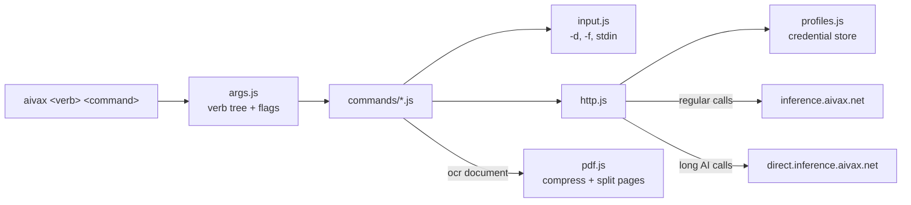

# AIVAX CLI

Operate an [AIVAX](https://aivax.net) account from the terminal: AI gateways, RAG collections, chat clients, batch jobs, agentic tests, web search, OCR, generations, conversations, skills, logs and account settings — from a shell, a script, CI, or a coding agent.

[](https://www.npmjs.com/package/@aivax/cli)
[](https://nodejs.org)
[](LICENSE)
[](https://docs.aivax.net/docs/cli.html)

## Contents

- [Requirements](#-requirements)
- [Installation](#️-installation)
- [Authentication](#-authentication)
- [Environment variables](#-environment-variables)
- [Usage](#-usage)
- [Transcribing documents locally](#-transcribing-documents-locally)
- [Conventions](#-conventions)
- [Verbs](#-verbs)
- [How it works](#-how-it-works)
- [Development](#-development)
- [Troubleshooting](#-troubleshooting)
- [Contributing](#-contributing)
- [License](#-license)

## 📋 Requirements

- [Node.js](https://nodejs.org) 22.19 or newer.
- An AIVAX account with a login key, or an account API key.
- An operating system credential store: Windows Credential Manager, macOS Keychain, or a Secret Service provider (GNOME Keyring, KWallet) on Linux. Scripts and CI can skip it with `AIVAX_API_KEY`.

## 🛠️ Installation

```bash
npm install -g @aivax/cli
aivax --help
```

Any package manager works (`pnpm add -g @aivax/cli`, `bun install -g @aivax/cli`), and `npx @aivax/cli <command>` runs it without a global install.

## 🔐 Authentication

```bash
aivax auth login                                                   # prompts for the login key and 2FA code
aivax auth login --login-key abc123 --2fa 123456 --profile-name "Conta principal"
aivax auth login --api-key sk-aiv-acc... --profile-name agente     # links an existing API key, no login key or 2FA
aivax auth profiles                                                # * marks the default profile
aivax auth use conta-principal
aivax auth whoami
aivax auth logout --profile-name "Conta principal"
```

Several named profiles can coexist on one device, and any command accepts `--profile <name>`. The profile name defaults to the sanitized account name (`João da Silva` → `joao-da-silva`).

Profile metadata is saved in `%APPDATA%/aivax-cli/profiles.json` on Windows, or `$XDG_CONFIG_HOME/aivax-cli` (`~/.config/aivax-cli`) elsewhere. The access key itself only goes to the system credential store.

To configure a coding agent with an account, `aivax docs setup` generates a setup prompt URL the agent can follow.

## 🌱 Environment variables

| Variable | Description | Default |
| --- | --- | --- |
| `AIVAX_API_KEY` | Uses an API key instead of a saved profile. Ignored when `--profile` is passed. | — |
| `AIVAX_ENDPOINT` | Overrides the API endpoint. | `https://inference.aivax.net` |
| `AIVAX_CLI_HOME` | Overrides the folder of `profiles.json`. | `%APPDATA%/aivax-cli` or `~/.config/aivax-cli` |
| `NO_COLOR` | Disables colored output in `aivax tests`. | — |

## 🚀 Usage

```bash
aivax gateways patch --id 01a10d22-1d8f-7a2b-8c0c-f38201a275fb -d '{"json": "grande de edição"}'
aivax web search -q "Previsão do tempo em São José do Rio Preto" --country BR
aivax rag search --collection 019d600d-1153-7b7f-b0b7-74a6046b6008 -q "Receita de macarrão instantâneo" -k 20 --reranker rrf
aivax ocr parse -f imagem.png > imagem.txt
aivax ocr document manual.pdf --format jsonl -o manual.jsonl
```

More examples:

```bash
aivax gateways chat -m my-gateway "Resuma este arquivo" -f contrato.pdf --stream
aivax rag import -c <collection> -f documentos.jsonl -f manual.pdf --context "Manual do produto"
aivax batch jobs create -w <workflow> -t "Lote de outubro"
aivax batch items import -w <workflow> -j <job> -f clientes.jsonl
aivax batch jobs start -w <workflow> -j <job>
aivax batch jobs export -w <workflow> -j <job> -o resultados.jsonl
aivax generate speech -m <model> -t @roteiro.txt -o narracao.mp3
aivax conversations list -g <gateway> --minutes 60
aivax tests evaluate -m checkout-gateway -g @objetivo.txt -c "Valide se o assistente confirma o total" --max-turns 6 -q high
aivax tests runs get --id <test> --run <run> --stream
aivax analytics balance
aivax api get /api/v1/notifications/unread/count
```

Every verb and command prints its options with `--help`. `aivax docs guide` summarizes the conventions, and `aivax docs reference <Endpoint>` shows the API reference of one endpoint.

## 📄 Transcribing documents locally

`aivax ocr document` transcribes a whole document page by page without uploading it to a collection:

```bash
aivax ocr document contrato.pdf -o contrato.md                         # Markdown with <!-- page N/TOTAL --> markers
aivax ocr document contrato.pdf --format jsonl -o contrato.jsonl       # segmented, RAG-ready JSONL
aivax rag import -c <collection> -f contrato.jsonl                     # optional: index the JSONL
```

PDFs are processed locally: large embedded images are recompressed as JPEG (max 2400 px side, quality 75, kept only when at least 20% smaller), and each page becomes a standalone PDF carrying only the resources it uses. Pages are grouped into requests of up to `--chunk-size` MB (default 5) and sent `--concurrency` at a time (default 4) to the OCR endpoint, so each text keeps its page number. With `--format jsonl`, each page is segmented. Other formats (images, Office, OpenDocument, RTF, CSV, EPUB, TXT, Markdown, HTML) are sent as one item.

- Requests retry 5 times on 429, 5xx and network errors.
- Progress, consumption in USD and ETA go to stderr. Blank pages are not errors. Pages that still fail are listed in `<output>.errors.txt` and the command exits with `1`.
- JSONL lines use `docid` `doc_<file>:pg<page>chk<crc32>`, `__ref` `rf_<file>:pg<page>` and `__meta` with `file_name`, `file_hash_sha1`, `file_hash_crc32`, `page`, `pages`, `page_chunk` and `extracted_at`.

`aivax rag import` streams all given JSONL files as a single WebSocket import (`/api/v2/.../documents/index-jsonl`), so `--sync` keeps the documents of every file. Invalid lines abort the import before `END`, so sync deletion does not run.

## 📐 Conventions

- **Request bodies**: `-d '<json>'`, `-d @file.json` or `-d -` (stdin). Field flags such as `--name` are merged over the `-d` body.
- **Files**: commands that send content accept `-f <file>` (repeatable). Media is sent as base64 data URLs or uploaded in multipart/chunks, as each endpoint requires.
- **Output**: responses are requested with `X-Response-Truncating: agent-optimized` (compact TOON text). `--verbose` returns the full JSON. Export and download commands accept `-o <file>`.
- **Long inference**: AI calls (chat completions, `/api/v1/generations/*`, `query`, `answer`, `web/fetch` and chat-client prompts) go to `direct.inference.aivax.net`, which has no proxy timeout, with a 20-minute client timeout.
- **Confirmation**: delete, reset, clear, roll-salt and similar commands ask for confirmation; `--yes` skips it, and non-interactive sessions require it.
- **Exit codes**: `0` success, `1` API or runtime error, `2` usage error.

## 🧭 Verbs

| Verb | Commands |
| --- | --- |
| `auth` | login, logout, profiles, use, whoami |
| `docs` | guide, reference, search, setup |
| `gateways` | list, get, create, patch, delete, chat |
| `rag` | search, similar, answer, collections (list, get, create, patch, delete, export, reset, reindex, transactions, dedup), documents (list, get, upsert, delete), import |
| `chat-clients` | list, get, create, patch, delete, sessions, integrations, schedules, talk, session |
| `models` | list, catalog |
| `batch` | workflows (CRUD), jobs (list, get, create, patch, start, pause, finish, delete, export), items (import, list, get, patch, delete, retry) |
| `tests` | list, get, create, patch, delete, run, runs (list, get, cancel), evaluate |
| `web` | search, fetch |
| `ocr` | parse, document |
| `analytics` | balance, usage, report, resources |
| `conversations` | list, get, export, delete |
| `skills` | list, get, create, patch, delete, import, export, clear, teach |
| `logs` | account, gateway, batch |
| `account` | update, keys (list, applications, create, delete), security, subscription, roll-salt, reset-login-key, notifications |
| `generate` | image, speech, transcribe, describe, summarize, translate, extract, classify, segment, rerank, decide, refine |
| `shell` | ls, stat, download, upload, publish, mkdir, rm, rmdir |
| `api` | raw call to any endpoint |

## 🧩 How it works

The CLI is plain JavaScript (ES modules) with no build step. `src/cli.js` parses the verb tree, each file in `src/commands` declares one verb, and every request goes through `src/http.js`.



| Library | Purpose |
| --- | --- |
| [`@napi-rs/keyring`](https://github.com/Brooooooklyn/keyring-node) | Stores access keys in the OS credential store. |
| [`@cantoo/pdf-lib`](https://github.com/cantoo-scribe/pdf-lib) | Splits PDFs into per-page documents. |
| [`sharp`](https://sharp.pixelplumbing.com) | Recompresses large PDF images as JPEG. |
| [`undici`](https://undici.nodejs.org) | Fetch without header/body timeouts for long inference calls. |
| [`mime`](https://github.com/broofa/mime) | Detects the media type of local files. |

## 🧑‍💻 Development

```bash
git clone https://github.com/aivaxlabs/cli.git
cd cli
npm install
node src/cli.js --help
```

`npm link` exposes the local checkout as the global `aivax` command. Point it at another environment with `AIVAX_ENDPOINT`, and keep test profiles apart with `AIVAX_CLI_HOME`.

There is no automated test suite yet. Validate changes by running the affected commands against a test account; a good starting point is `aivax auth whoami`, `aivax analytics balance` and `aivax models list`.

### Publishing

```bash
npm version <patch|minor|major>
npm publish --access public
```

Update `VERSION` in `src/http.js` to match, since it is sent in the `User-Agent` header and printed by `--help`.

## 🩺 Troubleshooting

| Symptom | Fix |
| --- | --- |
| `The access key of profile "…" is missing from the system credential store` | Run `aivax auth login` again. Profiles saved by the Bun-based 1.0.x releases use a different credential format and must be linked again once. |
| Credential store errors on Linux | Make sure a Secret Service provider (GNOME Keyring or KWallet) is running and unlocked, or use `AIVAX_API_KEY`. |
| `aivax: command not found` | Add npm's global bin folder (`npm prefix -g`, plus `/bin` outside Windows) to `PATH`. |
| `aivax api get /api/...` returns 404 in Git Bash | Git Bash rewrites arguments that start with `/`. Run with `MSYS_NO_PATHCONV=1` or drop the leading slash (`api/v1/...`). |
| `… requires an interactive terminal` | Pass the value through its flag, for example `--login-key` and `--2fa`, or `--yes` for confirmations. |

## 🤝 Contributing

1. Fork the repository and create a branch: `git checkout -b feat/my-change`.
2. Keep each verb in its own file under `src/commands` and reuse the helpers in `src/input.js` and `src/http.js`.
3. Check the affected commands and their `--help` output.
4. Open a pull request describing the change and how it was validated.

Issues and suggestions are welcome at [github.com/aivaxlabs/cli/issues](https://github.com/aivaxlabs/cli/issues).

## 📜 License

[MIT](LICENSE) © Project Principium.
